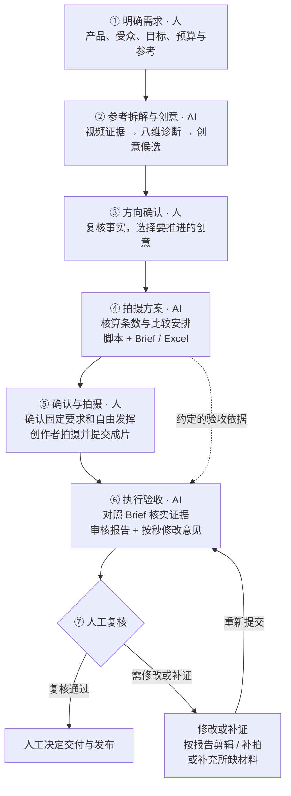

# Sherry · 短视频策划与交付审核助手

**为 AI 短视频策划与交付，建立一套可解释的共同标准。**

这个项目从“用 AI 写脚本”出发。在实际使用中，“更有吸引力”“有爆款感”很难直接变成清晰的生成要求。品牌、策划、创作者和 AI 对“好脚本”的理解可能不同，导致生成的方案难以比较、拍摄要求难以传达，成片也缺少共同的验收依据。

因此，我将参考视频拆解、脚本与拍摄任务单生成、成片审核连接起来，把抽象要求拆成具体问题：开头是否说明观看理由？产品信息是否清楚？创作者需要拍出哪些画面？成片是否完成了约定要求？每个判断尽量对应视频、字幕或拍摄要求中的证据，并形成可以执行的修改意见。

项目以用户提供的爆款或高表现视频为参考，借鉴行为经济学、认知心理学与传播研究，提炼可迁移的内容机制，并围绕曝光、种草或互动传播等目标组织脚本与拍摄方案。这套框架让内容产出有参照、拍摄交付有约定，也让不同方案能够按同一套维度进行比较。

> **English summary:** An AI-assisted workflow that turns user-supplied viral or high-performing reference videos into content hypotheses, scripts and creator briefs for awareness, product consideration and engagement. It draws on behavioral economics, cognitive psychology and communication research, with shared criteria for comparison and delivery review. The workflow is in practical use and has supported the production of 80 videos. Causal attribution requires real outcome data and a suitable comparison design.

## 30 秒了解这个作品

| 问题 | 回答 |
|---|---|
| 谁会用？ | 品牌运营、内容策划，以及负责对接视频创作者的人 |
| 帮助处理什么？ | 对“好脚本”的理解不一、方案难比较、拍摄要求不清、返修意见难执行 |
| 需要提供什么？ | 爆款等参考视频或待审成片、字幕、产品资料与目标；参考表现数据可一并提供，执行验收还需要原拍摄要求 |
| 能拿到什么？ | 内容诊断、拍摄 Brief / Excel、按时间排列的修改意见、执行审核报告 |
| 目前做到哪一步？ | 已投入实际使用，累计支持产出 80 条视频；公开案例采用合成素材 |

**推荐阅读顺序：**[两分钟作品概览](docs/portfolio-overview.md) → [完整脱敏案例](examples/swim-haircare/README.md) → [设计取舍与实现](docs/design-decisions.md)。

## 爆款参考、业务目标与理论依据

拿到用户提供的爆款或高表现视频后，先定位具体画面、台词与节奏，分析哪些设计可能影响“不划走、看完、点赞、评论、收藏、转发”，再筛选适用于当前产品的内容机制。输入是本地视频、已有分析报告或 Excel；样本是否属于“爆款”需结合用户提供的表现数据与比较基线确认，未提供数据时只作为参考素材。

可围绕以下目标调整内容分析和 Brief 重点。这些是策划用途，实际曝光、种草或传播效果需另行验证。

| 业务目标 | 内容策划重点 | 后续验证方向 |
|---|---|---|
| 曝光与认知 | 开头能否留人、品牌或产品是否清楚、是否具备易理解和可传播的内容线索 | 曝光与覆盖数据；留存、完播作为过程指标，品牌认知另行测量 |
| 产品种草 | 目标人群与场景是否匹配、产品价值是否具体、使用信息是否值得保留 | 有效咨询、商品访问或意向反馈；收藏是参考信号，不能直接等同购买意愿 |
| 互动与传播 | 是否给出具体的评论理由、收藏用途，以及值得转给谁的内容 | 按事先约定的口径比较点赞、评论、收藏与转发数据 |

理论框架借鉴**行为经济学、认知心理学与传播研究**中的概念，例如信息缺口、损失框架、自我关联、加工流畅性与社会传播，用于组织“内容元素 → 可能影响的用户决策 → 待验证指标”。研究出处、具体应用与外推边界见[理论依据与归因说明](docs/theory-and-attribution.md)。独立的[行为机制拆解工具](skills/sherry-douyin-behav/SKILL.md)可配合主流程使用，不参与八维总分。

**归因怎样开展：**先提出有素材证据的机制假设，再在预算允许时设计单变量 A/B 或策略与技巧的交叉比较，并记录执行差异。当前提供的是拆解、比较设计与复盘指南；效果归因还需要真实结果数据、可比的对照和合适的分析。单条爆款视频无法确认各元素贡献了多少流量。

## 从输入到交付，怎样工作

这张图展示从参考素材到成片交付的典型链路。使用者在 AI 工具中分阶段调用，并在关键节点确认；创作者负责拍摄，负责人作最终交付与发布决定。



**共同标准怎样贯穿流程：**

| 用在什么地方 | 依据与作用 |
|---|---|
| 内容产出 | 产品目标与参考证据帮助明确创意方向；脚本和 Brief 写清画面、台词、节拍，以及必须固定和可自由发挥的部分 |
| 交付验收 | 已确认的 Brief 转成逐项检查清单；审核报告列出证据、已知问题与材料缺口，修改意见落实到具体秒数和动作 |
| 同口径比较 | 脚本方案对照目标、内容方向与固定／可变要求；参考视频与成片使用同一八维诊断框架，比较时同时说明证据范围与缺项 |

内容诊断回答“哪些地方值得改”，执行验收回答“有没有按约定拍”。缺证据时保留“无法判断”或“待补证据”，补材料不等于要求补拍；已核实的问题则按报告修改后重新审核。

各模块也可单独使用：已有视频可直接诊断，已有 Brief 和成片可直接验收。真实发布后的效果比较需补充同口径数据与验证记录；内容评分与审核通过本身不能证明会成为爆款。

## 实际交付长什么样

下面是拍摄任务单的清单页。固定要求、创作者自由发挥和内部追踪分开记录，预算也先核对。


| 交付物 | 回答的问题 | 直接查看 |
|---|---|---|
| 内容诊断 | 这条视频哪里需要改，依据是什么？ | [八维诊断示例](examples/swim-haircare/diagnosis.md) |
| 拍摄修改清单 | 第几秒改什么，能剪辑还是需要补拍？ | [按秒修改指令](examples/swim-haircare/edits.md) |
| 拍摄 Brief / Excel | 创作者具体拍什么，哪些要求必须固定？ | [打开工作簿](examples/swim-haircare/brief.xlsx) |
| 执行审核 | 成片有没有按原要求拍，哪些项还缺证据？ | [审核报告](examples/swim-haircare/audit.md) |

**案例是合成测试素材，不是真实客户项目。** 视频长 12 秒，其中写着「产品特写」的画面实际只有图形和文字。审核需要指出产品仍未出现，不能把标签当实景。这个例子用来展示证据核对与交付方式；没有真实投放收益、节省工时或模型准确率结论。

原片、参考图、关键帧和完整过程见[泳后护发合成案例](examples/swim-haircare/README.md)。

## 完整实现包含什么

| 任务 | 入口 | 交付 |
|---|---|---|
| 诊断成片 | [sherry-douyin-review](skills/sherry-douyin-review/SKILL.md) | 八维内部报告、按秒修改指令、参考摘要 |
| 生成拍摄方案 | [sherry-brief](skills/sherry-brief/SKILL.md) | 创意、预算分配、拍摄 Brief、Excel |
| 对照约定验收 | [sherry-douyin-shenhe](skills/sherry-douyin-shenhe/SKILL.md) | 逐项证据、审核结论、补拍／剪辑清单 |
| 提出行为机制假设 | [sherry-douyin-behav](skills/sherry-douyin-behav/SKILL.md) | 六类用户行为的可能解释，不参与八维打分 |

八个专项可单独调用：开头 `kaitou`、完播 `wanbo`、点赞 `like`、评论 `comment`、收藏 `fav`、转发 `share`、视觉传达 `shijue`、文案精度 `wenzi`。完整名称均为 `sherry-douyin-` 加上述后缀。

## 设计重点

1. **统一证据接口。** `ffprobe` 获取媒体信息，SHA256 标识源视频；三层抽帧与 SRT 生成同一时间映射，专项复用这些产物。
2. **诊断与验收分工。** 前者回答内容哪里需要改，后者回答有没有按 Brief 拍；视觉传达与文案精度也分别处理。
3. **未知状态贯穿交付。** N/A 不补分、不当作弱机制；缺项时不凑完整总评。已确定的关键缺失仍可直接判不通过。
4. **失败不伪装成成功。** 抽帧经本轮临时文件验证后才替换旧图；镜头检测失败会停止，目录内旧文件不能作为本轮依据。
5. **先算资源，再设计比较。** 小预算直出脚本；A/B 和矩阵先核算条数及余量，数量档位不等于统计功效或因果证明。

这些设计及其取舍见[设计说明](docs/design-decisions.md)。

## 安装与复现

<details>
<summary><strong>供希望运行或技术复核的读者展开</strong></summary>

需要 Python 3、ffmpeg / ffprobe，以及能读取本地文件和图片的 AI 工具。安装入口面向 Bash 环境，默认将 Skill 复制到 Claude Code 常用目录；其他宿主需指定安装目录并确认工具能力。

在仓库根目录运行：

```bash
# macOS 缺少 ffmpeg 时：brew install ffmpeg
bash setup.sh

# 已有依赖：只安装 Skill 并跑自检
bash setup.sh --skip-deps

# 回归测试
python3 -B -m unittest discover -s tests -v
```

默认安装 Excel 依赖并运行自带 SRT 的预处理自检。自动转写按需使用 `bash setup.sh --with-transcription` 安装；首次转写可能下载模型。

示例调用（路径替换为本地绝对路径）：

```text
/sherry-douyin-review 请诊断【视频路径】，字幕在同目录，主要目标是收藏。
/sherry-brief 产品信息见附件，计划拍6条，请先读取【已有诊断报告路径】。
/sherry-douyin-shenhe 请对照【Brief路径】审核【视频路径】。
```

不支持斜杠调用时，直接让 AI 读取对应 `SKILL.md`。多 Agent 不可用时按八维顺序执行，不省略维度。Python 环境、安装位置与常见用法见[使用说明](使用说明.md)；分步验收见[验收清单](验收清单.md)。

安装步骤是技术复核入口；查看作品概览与案例无需先安装。

</details>

## 验证范围

项目已投入实际使用，累计支持产出 80 条视频。为保护商业信息，仓库公开合成演示与配套工具；本次公开验证覆盖本地安装、目录移动与重复安装、预处理边界、标准合成样例，以及缺证据的规则场景。使用规模由项目维护者提供，公开材料尚未包含投放效果、评分准确率或工时收益的量化验证记录。静帧与逐字稿也不能证明音频听感或真实用户心理。

实际环境、测试结果、历史转写与本次演示的区别见[验证记录](docs/validation.md)。示例中的产品名称和台词是测试输入，不作为商品功效事实。

## 目录

```text
skills/                     12 个 Skill 与共用脚本
tests/                      安装和预处理回归
测试素材/                   原始合成视频、SRT、Brief 与参考图
examples/swim-haircare/      完整示范及可查看的交付物
docs/                       设计取舍与验证范围
setup.sh                    可移动的安装入口
```

维护标识：Sherry。本项目仅用于作品展示，保留全部版权；复用需另行取得书面授权，见 [LICENSE](LICENSE)。
