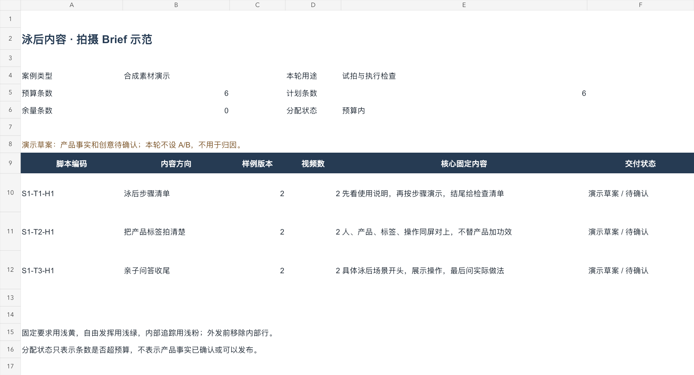
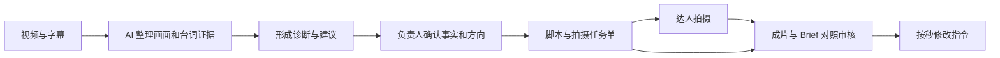

# Sherry · 短视频策划与交付审核助手

**把“看参考视频、写拍摄要求、检查成片”串成一套 AI 辅助流程。**

给它本地视频、字幕和产品要求，它会协助整理内容诊断、拍摄任务单（Brief）、脚本和按秒修改清单。负责人仍然确认产品事实、选择创意，并作最终发布决定。

这里的 **Skill** 是给 AI 使用的工作手册和配套工具。阅读作品与案例无需懂代码，也无需先安装环境。

> **English summary:** An AI-assisted workflow prototype for creator briefs and video delivery review. It turns source material and requirements into traceable drafts and checks, while people retain factual validation, creative decisions and release approval.

## 30 秒了解这个作品

| 问题 | 回答 |
|---|---|
| 谁会用？ | 品牌运营、内容策划，以及负责对接视频创作者的人 |
| 帮助处理什么？ | 参考视频拆解零散、拍摄要求不清、返修意见难执行、缺材料时判断不确定 |
| 需要提供什么？ | 参考或成片视频、字幕、产品资料与目标；执行验收还需要原拍摄要求 |
| 能拿到什么？ | 内容诊断、拍摄 Brief / Excel、按时间排列的修改意见、执行审核报告 |
| 目前做到哪一步？ | 可运行原型与合成示范，已有本地测试；真实团队使用效果尚待试点 |

**推荐阅读顺序：**[两分钟作品概览](docs/portfolio-overview.md) → [完整脱敏案例](examples/swim-haircare/README.md) → [设计取舍与实现](docs/design-decisions.md)。

本项目用于展示 **AI Transformation Intern** 相关的流程拆解、人机分工、原型落地与验证思路。部分文档、脚本修订与示例使用了 AI 协助，不宣称独立训练模型或完成真实企业部署。

## 实际交付长什么样

下面是拍摄任务单的清单页。固定要求、创作者自由发挥和内部追踪分开记录，预算也先核对。



| 交付物 | 回答的问题 | 直接查看 |
|---|---|---|
| 内容诊断 | 这条视频哪里需要改，依据是什么？ | [八维诊断示例](examples/swim-haircare/diagnosis.md) |
| 拍摄修改清单 | 第几秒改什么，能剪辑还是需要补拍？ | [按秒修改指令](examples/swim-haircare/edits.md) |
| 拍摄 Brief / Excel | 创作者具体拍什么，哪些要求必须固定？ | [打开工作簿](examples/swim-haircare/brief.xlsx) |
| 执行审核 | 成片有没有按原要求拍，哪些项还缺证据？ | [审核报告](examples/swim-haircare/audit.md) |

**案例是合成测试素材，不是真实客户项目。** 视频长 12 秒，其中写着「产品特写」的画面实际只有图形和文字。审核需要指出产品仍未出现，不能把标签当实景。这个例子用来展示证据核对与交付方式；没有真实投放收益、节省工时或模型准确率结论。

原片、参考图、关键帧和完整过程见[泳后护发合成案例](examples/swim-haircare/README.md)。

## 从输入到交付，怎样工作

| 环节 | AI 辅助工作 | 人需要负责 | 交付 |
|---|---|---|---|
| 输入与素材准备 | 提取时间轴、字幕和帧图 | 确认产品事实、目标、输入权限与完整性 | 可追溯素材包 |
| 内容诊断 | 分维度整理证据与修改建议 | 复核关键判断、决定是否采纳 | 内部诊断和按秒清单 |
| 拍摄方案 | 提出创意、核算预算、组织 Brief | 确认方向、固定要求与可自由发挥部分 | 拍摄 Brief / Excel |
| 执行验收 | 按 Brief 对照、列出缺失和未知项 | 补充证据、复核修改、作最终发布决定 | 审核与修改报告 |



内容诊断看「哪里需要改」；执行审核看「有没有按约定拍」。两种任务分开。没有证据时保留「无法判断」或「待补证据」，不为了填满报告给出猜测性结论。

## 完整实现包含什么

| 任务 | 入口 | 交付 |
|---|---|---|
| 诊断成片 | [sherry-douyin-review](skills/sherry-douyin-review/SKILL.md) | 八维内部报告、按秒修改指令、参考摘要 |
| 生成拍摄方案 | [sherry-brief](skills/sherry-brief/SKILL.md) | 创意、预算分配、拍摄 Brief、Excel |
| 对照约定验收 | [sherry-douyin-shenhe](skills/sherry-douyin-shenhe/SKILL.md) | 逐项证据、审核结论、补拍／剪辑清单 |
| 提出行为机制假设 | [sherry-douyin-behav](skills/sherry-douyin-behav/SKILL.md) | 六类用户行为的可能解释，不参与八维打分 |

八个专项可单独调用：开头 `kaitou`、完播 `wanbo`、点赞 `like`、评论 `comment`、收藏 `fav`、转发 `share`、视觉传达 `shijue`、文案精度 `wenzi`。完整名称均为 `sherry-douyin-` 加上述后缀。

## 设计重点

1. **统一证据接口。** `ffprobe` 获取媒体信息，SHA256 标识源视频；三层抽帧与 SRT 生成同一时间映射，专项复用这些产物。
2. **诊断与验收分工。** 前者回答内容哪里需要改，后者回答有没有按 Brief 拍；视觉传达与文案精度也分别处理。
3. **未知状态贯穿交付。** N/A 不补分、不当作弱机制；缺项时不凑完整总评。已确定的关键缺失仍可直接判不通过。
4. **失败不伪装成成功。** 抽帧经本轮临时文件验证后才替换旧图；镜头检测失败会停止，目录内旧文件不能作为本轮依据。
5. **先算资源，再设计比较。** 小预算直出脚本；A/B 和矩阵先核算条数及余量，数量档位不等于统计功效或因果证明。

这些设计及其取舍见[设计说明](docs/design-decisions.md)。

## 安装与复现

<details>
<summary><strong>供希望运行或技术复核的读者展开</strong></summary>

需要 Python 3、ffmpeg / ffprobe，以及能读取本地文件和图片的 AI 工具。安装入口面向 Bash 环境，默认将 Skill 复制到 Claude Code 常用目录；其他宿主需指定安装目录并确认工具能力。

在仓库根目录运行：

```bash
# macOS 缺少 ffmpeg 时：brew install ffmpeg
bash setup.sh

# 已有依赖：只安装 Skill 并跑自检
bash setup.sh --skip-deps

# 回归测试
python3 -B -m unittest discover -s tests -v
```

默认安装 Excel 依赖并运行自带 SRT 的预处理自检。自动转写按需使用 `bash setup.sh --with-transcription` 安装；首次转写可能下载模型。

示例调用（路径替换为本地绝对路径）：

```text
/sherry-douyin-review 请诊断【视频路径】，字幕在同目录，主要目标是收藏。
/sherry-brief 产品信息见附件，计划拍6条，请先读取【已有诊断报告路径】。
/sherry-douyin-shenhe 请对照【Brief路径】审核【视频路径】。
```

不支持斜杠调用时，直接让 AI 读取对应 `SKILL.md`。多 Agent 不可用时按八维顺序执行，不省略维度。Python 环境、安装位置与常见用法见[使用说明](使用说明.md)；分步验收见[验收清单](验收清单.md)。

安装步骤是技术复核入口；查看作品概览与案例无需先安装。

</details>

## 验证范围

已覆盖本地安装、目录移动与重复安装、预处理边界、标准合成样例，以及缺证据的规则场景。当前没有真实投放数据、效果提升幅度、评分准确率或工时收益证据；静帧与逐字稿也不能证明音频听感或真实用户心理。

实际环境、测试结果、历史转写与本次演示的区别见[验证记录](docs/validation.md)。示例中的产品名称和台词是测试输入，不作为商品功效事实。

## 目录

```text
skills/                     12 个 Skill 与共用脚本
tests/                      安装和预处理回归
测试素材/                   原始合成视频、SRT、Brief 与参考图
examples/swim-haircare/      完整示范及可查看的交付物
docs/                       设计取舍与验证范围
setup.sh                    可移动的安装入口
```

维护标识：Sherry。本项目仅用于作品展示，保留全部版权；复用需另行取得书面授权，见 [LICENSE](LICENSE)。

本仓库公开完整 Skill、脚本、测试与脱敏案例。授权范围不因公开而改变，详见 [LICENSE](LICENSE)；材料范围与处理记录见[脱敏检查记录](docs/privacy-review.md)。

首页的信息组织参考了同类项目的流程表、能力入口与验证边界写法，参考及取舍见[同类项目展示调研](docs/github-presentation-references.md)。
