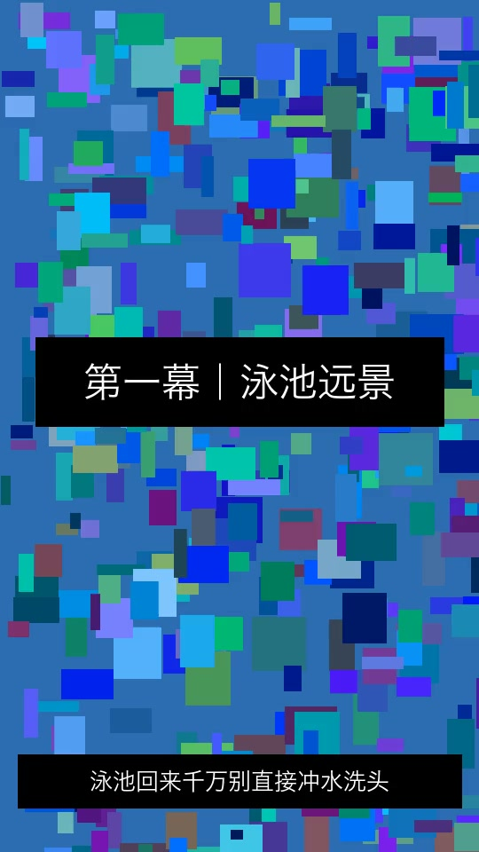
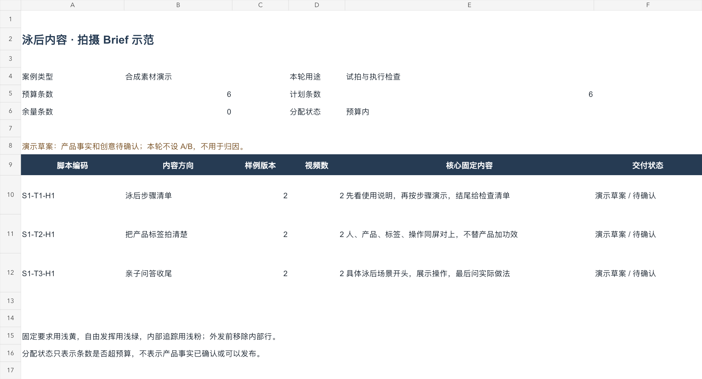

# 泳后护发：从素材到拍摄交付

**合成案例 · 本次新生成的示范 · 不代表真实投放效果**

本案例复用仓库已有的 12 秒视频、SRT、原始 Brief 和参考图，补齐可查看的交付物。它展示如何从具体证据提出修改、形成拍摄草案并核对执行要求；没有真实产品资料、达人拍摄或发布数据。

## 输入与交付

| 环节 | 打开查看 | 来源与用途 |
|---|---|---|
| 原始素材 | [视频](../../测试素材/样例_泳后护发.mp4)、[SRT](../../测试素材/样例_泳后护发.srt) | 复用现有合成输入，未改写 |
| 验收依据 | [原 Brief](../../测试素材/Brief_口播文案.md)、[必拍画面参考](../../测试素材/Brief_必拍画面参考.png) | 本次审核仍对照这份原始要求 |
| 预处理 | [摘要](artifacts/summary.md)、[帧映射](artifacts/mapping.json)、[镜头统计](artifacts/scenes.json) | 当前脚本本次运行；18 帧、4 字幕、3 镜头 |
| 内容诊断 | [八维内部诊断](diagnosis.md) | 总评 2.5/5，8/8 已评分；仅作内容设计预判 |
| 拍摄修改 | [按秒修改指令](edits.md) | 区分已有证据、待补材料、剪辑修改与需要补拍 |
| 新拍摄草案 | [下载 Excel](brief.xlsx) | 6 个工作表、3 份 Brief、计划共 6 条；每份含两版完整样例，不设 A/B |
| 原片验收 | [执行审核](audit.md) | 不通过；已见图形文字卡不能替代真实必拍画面 |

**流程顺序说明：**先诊断原片，再据此提出新的拍摄草案；审核示范比较的是原片与原始 Brief。新草案尚未拍摄，也没有对其成片验收，不能把这些文件说成已完成真实商业交付。

## 证据里实际有什么

| 0.00 秒 | 4.20 秒 | 8.50 秒 |
|---|---|---|
|  |  |  |

帧上写着「泳池远景」「产品特写」，不等于出现了真实泳池或产品。当前图像支持的关键结论是：缺少主体、产品与操作画面。SRT 与画面内文字也有差异，例如 SRT 的效果句没有同期出现在画面里；这不等于已听音确认了口播错误或音画延迟。

## Excel 展示



工作表包括「脚本清单与说明」、三份 S/T/H 编码的 Brief、「比较与复盘指南」和「演示输入」。每份 Brief 都有概要、开场、固定节拍、产品植入、收尾、自由元素、两版完整样例、内部数据追踪。

预算输入在「演示输入」B7，清单中的计划视频数为每份 2 条，共 6 条。预算改成 5 时汇总会显示超预算；这一状态只核对条数，不表示产品事实已确认或成片可发布。固定、自由和内部内容分别用浅黄、浅绿、浅粉区分，内部行外发前移除。

新草案只迁移泳后场景、步骤结构和结尾提问。原文「用了三天氯味完全没了」没有证据支撑，未写成新脚本的商品事实；实际操作应在产品说明确认后填写。

## 复用历史转写，展示一个已知限制

[历史自动转写 SRT](asr-historical.srt)来自已有验收产物，本次没有重新下载模型或转写。

| 原始测试字幕中的词 | 历史转写中的词 |
|---|---|
| 泳池 | 用池 |
| 去氯洗沐 | 去绿洗墓 |
| 氯味 | 绿味 |

因此当前演示使用自带 SRT，而不是把原始 ASR 直接当成可靠产品词。历史 ASR 有 5 条字幕；本次基于自带 SRT 的 4 条字幕和 18 帧不能与旧版的帧数混用。

## 如何重跑素材准备

在仓库根目录运行：

```bash
python3 skills/sherry-douyin-review/scripts/prepare_video.py 测试素材/样例_泳后护发.mp4 --scenes --out-root outputs/案例复核
```

应得到 12 秒、18 帧、4 字幕、切点 4.0/8.0 秒。源视频 SHA256：`4ad71c4340471289fb51415bd1729d97934b847f3f038b5dfd8a0b00b11ad028`。公开副本仅将 JSON 和摘要里的本机路径换成仓库相对路径。

这些命令只重建素材，不会自动复现同一份模型评分、替你确认创意或拍摄成片。完整的环境与验证边界见[验证记录](../../docs/validation.md)。
